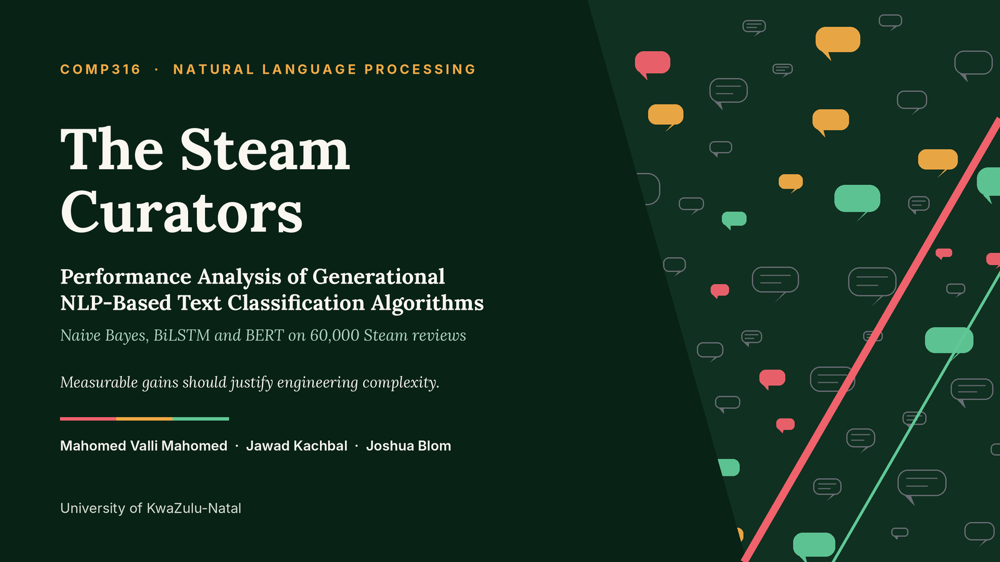
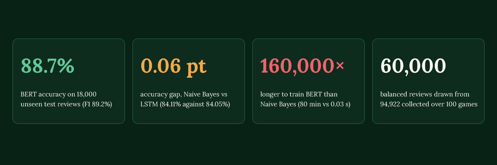
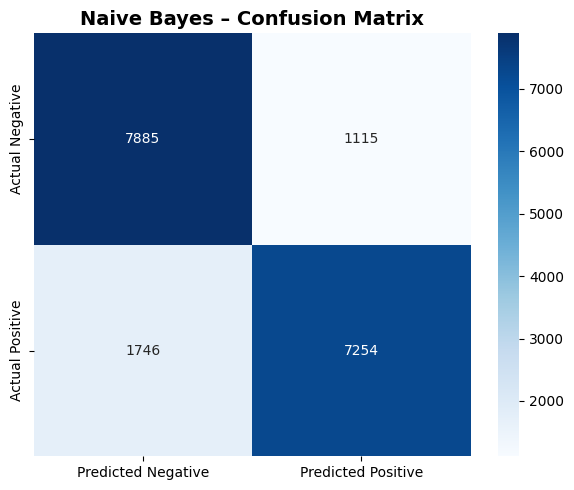
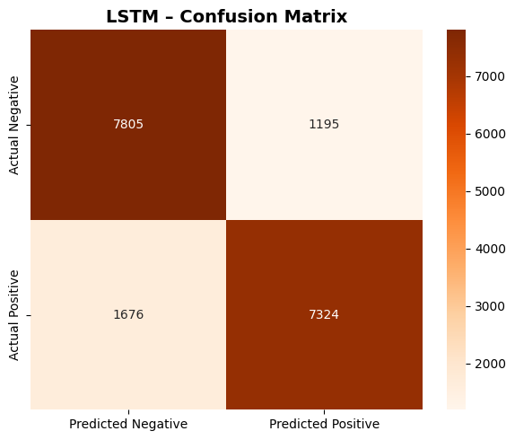
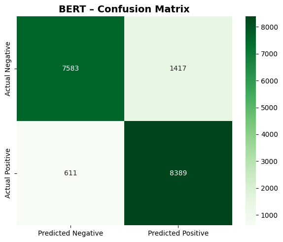
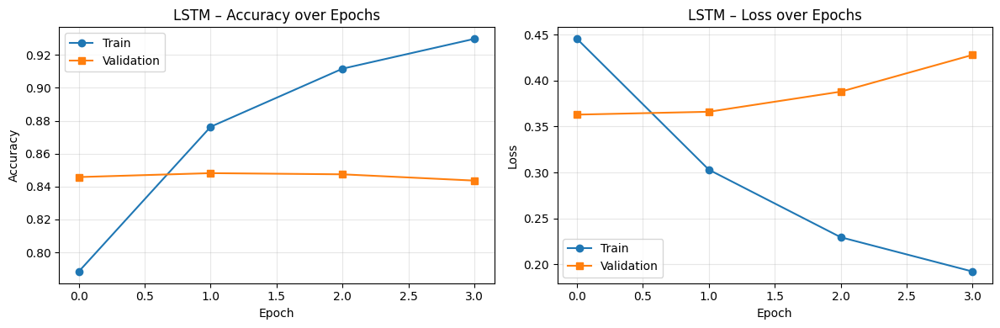
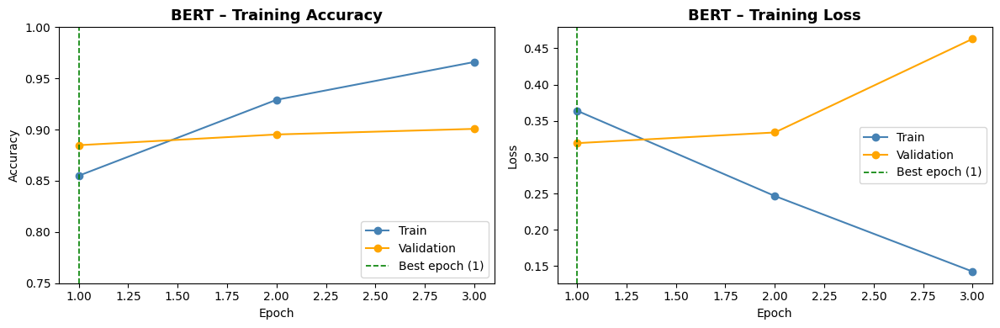

<a id="top"></a>
<p align="center"></p>

<p align="center">     </p>

<h3 align="center"><i>“Measurable gains should justify engineering complexity.”</i></h3>

<p align="center">
<a href="COMP316%20Project%20Report%20FINAL.pdf"><b>Final report (PDF)</b></a> &nbsp;·&nbsp;
<a href="COMP316_PROJECT_COMPLETE_Combined%20Notebooks.ipynb"><b>Combined notebook</b></a> &nbsp;·&nbsp;
<a href="#running-the-project"><b>Run it</b></a> &nbsp;·&nbsp;
<a href="#5-results"><b>Jump to the results</b></a>
</p>

<p align="center"></p>

> [!NOTE]
> This README presents our final report as **The Steam Curators** for COMP316 (Natural Language Processing, UKZN, May 2026), chapter by chapter. Every figure quoted here is taken from our saved notebook outputs and from [`bert_metrics.csv`](Locally%20Trained%20Bert%20Files/COMP316/bert_metrics.csv); the BERT numbers were also recomputed from the 18,000 rows of [`bert_predictions.csv`](Locally%20Trained%20Bert%20Files/COMP316/bert_predictions.csv).

<p align="center"></p>

## Abstract

Natural Language Processing has moved quickly over the last decade, and the models behind today's large language models descend from much simpler ancestors. This project steps back and compares **three generations of text classifier** on one fundamental task: binary sentiment classification of real, user-written Steam game reviews. The three models are a traditional statistical model (**Multinomial Naive Bayes** with TF-IDF), a recurrent deep-learning model (a **Bidirectional LSTM**) and a fine-tuned transformer (**BERT**, `bert-base-uncased`).

Reviews were collected through the Steam Web API, cleaned, balanced and split once into **42,000 training and 18,000 test reviews**; all three models were trained and scored on exactly those files. **BERT is clearly best, with 88.73% accuracy and an F1-score of 89.22%**, against 84.11% and 83.53% for Naive Bayes and 84.05% and 83.61% for the LSTM. The older two are practically level with each other, which suggests that the sentiment signal in short Steam reviews is largely lexical. BERT's lead has a price: about **80 minutes of GPU training** against 35 seconds for the LSTM and 0.03 seconds for Naive Bayes, and **231 seconds to score the test set** against 1.05 seconds and 0.01 seconds.

**Keywords:** sentiment analysis, text classification, Naive Bayes, LSTM, BERT, transfer learning, Steam reviews, computational cost.

[Back to top ↑](#top)

## Contents

**About the project**

- [Abstract](#abstract)
- [Project formalities](#project-formalities)
- [Repository map](#repository-map)
- [Running the project](#running-the-project)

**The study**

1. [Introduction](#1-introduction)
2. [Research question](#2-research-question)
3. [The dataset](#3-the-dataset)
4. [Approach](#4-approach)
5. [Results](#5-results)
6. [Discussion](#6-discussion)
7. [Limitations](#7-limitations)
8. [Conclusion](#8-conclusion)

**Back matter**

- [References](#references)
- [AI disclosure](#ai-disclosure)
- [Licence and attribution](#licence-and-attribution)

<p align="center"></p>

## Project formalities

|               |                                                                          |
|---------------|--------------------------------------------------------------------------|
| **Course**    | COMP316 Natural Language Processing (2026), University of KwaZulu-Natal  |
| **Topic**     | Performance Analysis of Generational NLP-Based Text Classification Algorithms |
| **Task**      | Binary sentiment classification of Steam game reviews                    |
| **Group**     | The Steam Curators                                                       |
| **Submitted** | May 2026                                                                 |

| Member                | Student number | Model trained |
|-----------------------|----------------|---------------|
| Jawad Kachbal         | 223037045      | BERT          |
| Joshua Blom           | 224039813      | LSTM          |
| Mahomed Valli Mahomed | 224005878      | Naive Bayes   |

### Deliverables

| Deliverable                                  | Where                                                                                                                                  |
|----------------------------------------------|----------------------------------------------------------------------------------------------------------------------------------------|
| Final report                                 | [`COMP316 Project Report FINAL.pdf`](COMP316%20Project%20Report%20FINAL.pdf)                                                           |
| All four notebooks, merged, with outputs     | [`COMP316_PROJECT_COMPLETE_Combined Notebooks.ipynb`](COMP316_PROJECT_COMPLETE_Combined%20Notebooks.ipynb)                             |
| One notebook per stage                       | [`Individual Notebooks/`](Individual%20Notebooks)                                                                                      |
| Train and test data, and the raw collection  | [`Data Used/`](Data%20Used)                                                                                                            |
| BERT outputs: metrics, predictions, plots    | [`Locally Trained Bert Files/COMP316/`](Locally%20Trained%20Bert%20Files/COMP316)                                                      |

## Repository map

```
.
├── README.md                                           this page: the full study and how to run it
├── COMP316 Project Report FINAL.pdf                    our report as submitted
├── COMP316_PROJECT_COMPLETE_Combined Notebooks.ipynb   preprocessing, Naive Bayes, LSTM and BERT in one
│                                                       notebook, with every output from the final runs
├── docs/readme/                                        images used by this page (banners, figures)
│
├── Data Used/
│   ├── steam_reviews_final_RAW.csv                     the raw collection from the Steam Web API
│   ├── steam_reviews_train_FINAL.csv                   42,000 training reviews (21,000 / 21,000)
│   ├── steam_reviews_test_NO_SENTIMENT_FINAL.csv       18,000 test reviews, labels removed (model input)
│   └── steam_reviews_test_WITH_SENTIMENT_FINAL.csv     the same 18,000 reviews with labels (scoring)
│
├── Individual Notebooks/
│   ├── COMP316_PROJECT__DATA_FINAL.ipynb               collection, cleaning, balancing, splitting
│   ├── naive_bayes_steam_FINAL_COMPLETE.ipynb          TF-IDF + MultinomialNB
│   ├── lstm_steam_FINAL_COMPLETE.ipynb                 Bidirectional LSTM (Google Colab)
│   └── bert_steam_FINAL COMPLETE.ipynb                 BERT fine-tuning (local GPU)
│
└── Locally Trained Bert Files/COMP316/
    ├── bert_metrics.csv                                accuracy, precision, recall, F1, timings
    ├── bert_predictions.csv                            review_id, predicted and true sentiment, 18,000 rows
    ├── bert_confusion_matrix.png                       BERT confusion matrix
    ├── bert_training_history.png                       BERT accuracy and loss over three epochs
    ├── bert_steam_FINAL COMPLETE.ipynb                 commented BERT notebook with outputs (use this one)
    ├── bert_steam_FINAL.ipynb                          the same notebook before it was run (no outputs)
    ├── bert_steam_model/                               model config and tokeniser (weights not included)
    └── data/                                           copy of the data files used for local training
```

[Back to top ↑](#top)

<p align="center"></p>

## Running the project

All results are already stored in the notebook outputs, so the findings can be inspected without running anything (option A). Re-running Naive Bayes and the LSTM is quick; re-running BERT needs a CUDA GPU and about two to three hours.

| You need                                      | For                                      | Notes                                   |
|-----------------------------------------------|------------------------------------------|-----------------------------------------|
| Jupyter or Google Colab                       | viewing and running the notebooks        | Colab was used for Naive Bayes and LSTM |
| Python 3.12, scikit-learn, NLTK               | Naive Bayes                              | installed by the notebook               |
| TensorFlow / Keras                            | the BiLSTM                               | installed by the notebook               |
| PyTorch (CUDA), `transformers`                | BERT                                     | trained locally on a GTX 1060 (6 GB)    |
| `langdetect`, `emoji`, `requests`             | the data pipeline                        | only needed to rebuild the dataset      |

### A. Read the results

Open [`COMP316_PROJECT_COMPLETE_Combined Notebooks.ipynb`](COMP316_PROJECT_COMPLETE_Combined%20Notebooks.ipynb) in Jupyter, Colab or on GitHub. Every cell output from the completed runs is preserved.

### B. Re-run Naive Bayes or the LSTM (Colab)

1. Upload the notebook and the three CSV files from `Data Used/` to Google Drive.
2. Set `DATA_PATH` in the notebook to your Drive folder.
3. Choose **Runtime → Run all**.

The LSTM notebook fixes `np.random.seed(42)` and `tf.random.set_seed(42)`.

### C. Re-train BERT (local GPU)

```
pip install torch torchvision torchaudio --index-url https://download.pytorch.org/whl/cu118
pip install transformers pandas scikit-learn matplotlib seaborn jupyter

python -c "import torch; print(torch.cuda.is_available())"
jupyter notebook
```

Open `Locally Trained Bert Files/COMP316/bert_steam_FINAL COMPLETE.ipynb`, set `DATA_PATH` in the Configuration cell to your local data folder, and run all cells. Expect about 80 minutes of training on a GTX 1060 plus about four minutes of inference.

> [!IMPORTANT]
> The fine-tuned weights (`model.safetensors`, a few hundred MB) are excluded from the repository by `.gitignore`, so `bert_steam_model/` holds only the configuration and tokeniser. `BertForSequenceClassification.from_pretrained('./bert_steam_model')` will not work from a fresh clone until the model has been re-trained or the weights file is restored. The per-review results that our report uses are all kept in `bert_predictions.csv`.

### D. Rebuild the dataset (optional)

`COMP316_PROJECT__DATA_FINAL.ipynb` collects reviews from the Steam Web API, cleans them, balances the classes and writes the train and test files. Collection is slow because of API rate limits and was done with deliberate delays between requests; the committed CSV files are the ones used in the study, so rebuilding is not needed to reproduce the results.

[Back to top ↑](#top)

<p align="center"></p>

## 1 Introduction

### 1.1 Background and motivation

Natural Language Processing (NLP) algorithms have improved rapidly over the last decade and are now the foundation of modern large language models. That progress came in distinct steps: statistical models built on word counts, recurrent neural networks that read text in sequence, and transformers pre-trained on enormous corpora. Each step added accuracy and added cost. This project examines those three generations side by side, on the same data and under the same evaluation, to see what each step actually buys.

### 1.2 Why Steam reviews

Steam is the largest digital distribution platform for PC games, and its review system suits this study well. Only players who own a game and have at least 30 minutes of playtime can review it, so reviews reflect real engagement. Every review also carries a **Recommended / Not Recommended** tag that the author chooses when posting, so the label is not inferred or predicted: it is the author's own judgement, which maps cleanly to 1 (positive) and 0 (negative). The review text itself is free-form, from a single word to a structured essay, which makes the data both realistic and challenging.

<p align="center"></p>

<p align="center"><sub><b>Figure 1.</b> A positive Steam review (username removed, app id 2246340). The Recommended tag is the label.</sub></p>

### 1.3 Contributions

- **A cleaned, balanced dataset** of 60,000 English Steam reviews, split once into fixed train and test files shared by all three models.
- **A like-for-like comparison** of a traditional, a recurrent and a transformer model, each with preprocessing suited to its architecture.
- **A cost-aware evaluation** that reports accuracy, precision, recall and F1 together with wall-clock training and inference time.

[Back to top ↑](#top)

<p align="center"></p>

## 2 Research Question

> How do classification accuracy, precision, recall and F1-score compare across a Traditional ML model (Naive Bayes), a Deep Learning model (LSTM) and a Transformer-based model (BERT) when applied to the same binary sentiment classification task on real-world user-generated text?

The task is, given a Steam review, to predict whether the sentiment is **positive (1)** or **negative (0)**. Time is part of the question: training and inference time were recorded for every model because they decide which model is practical in production.

[Back to top ↑](#top)

<p align="center"></p>

## 3 The Dataset

### 3.1 Collection

Reviews were collected with the Steam Web API's App Reviews endpoint for **100 selected games**. The endpoint returns at most 100 reviews per request, so the pipeline used cursor-based pagination and kept going until it had 500 positive and 500 negative reviews per game, or ran out of pages. It waited between requests to avoid throttling, saved reviews to CSV after each game, and checked for duplicates at write time so that a restart could not insert repeats. Only English and purchased-game reviews were requested. The result was a raw collection of **94,922 reviews**.

### 3.2 Cleaning

The language setting on a Steam account is not the language of a review, so the raw data needed substantial cleaning. The steps below were applied in order; the counts are printed by the combined notebook.

| Step                              | What it removes                                                                                                         | Reviews removed |
|-----------------------------------|-------------------------------------------------------------------------------------------------------------------------|----------------:|
| Corrupted encoding                | Reviews containing `♥` (Steam's profanity mask) or its mis-decoded form, which corrupt the surrounding text             | 6,467           |
| Links                             | Reviews containing `http://` or `www.`, typically promotional or spam                                                   | 216             |
| Language filter (`langdetect`)    | Reviews not actually written in English, even when the account's client language is English                            | 21,950          |
| Emoji                             | Reviews with emoji, which Naive Bayes and word-level embeddings cannot interpret and BERT's WordPiece fragments        | 538             |
| Spam patterns                     | Four or more repeated characters, runs of decorative Unicode, and reviews made only of symbols                          | 1,183           |
| Empty reviews                     | Reviews that were blank after the steps above                                                                           | 0               |
| **Remaining after cleaning**      |                                                                                                                         | **64,568**      |

The cleaned data held 30,805 positive and 33,763 negative reviews. Random sampling then balanced it to **30,000 per class**.

### 3.3 Final dataset

The 60,000 reviews were split 70:30 with stratification, then re-indexed with sequential `review_id` values. Ninety-six of the 100 collected games are represented in the final files.

| Split        | Total reviews | Positive (1) | Negative (0) |
|--------------|--------------:|-------------:|-------------:|
| Training set | 42,000        | 21,000       | 21,000       |
| Test set     | 18,000        | 9,000        | 9,000        |
| **Total**    | **60,000**    | **30,000**   | **30,000**   |

**Table 1.** Final dataset composition. All three models were trained and evaluated on these same files.

[Back to top ↑](#top)

<p align="center"></p>

## 4 Approach

### 4.1 Three generations, three models

Each model is the canonical baseline of its generation, which is what makes the comparison meaningful.

| Model                    | Paradigm                    | Generation | Library                  | Trained on          |
|--------------------------|-----------------------------|------------|--------------------------|---------------------|
| Naive Bayes + TF-IDF     | Traditional statistical ML  | 1st        | scikit-learn             | Google Colab        |
| Bidirectional LSTM       | Recurrent deep learning     | 2nd        | TensorFlow / Keras       | Google Colab (GPU)  |
| BERT (`bert-base-uncased`) | Transformer fine-tuning   | 3rd        | Hugging Face Transformers | Local GTX 1060 6 GB |

**Table 2.** The models compared.

### 4.2 Preprocessing and configuration

Each architecture represents text differently, so each has its own preprocessing. The cleaning in Chapter 3 is shared by all three.

| | **Naive Bayes** | **Bidirectional LSTM** | **BERT** |
|---|---|---|---|
| **Text preparation** | Lowercase, strip non-letters, NLTK English stopwords removed, Porter stemming | Lowercase, strip non-letters, stopwords removed **but negations kept** (not, no, never, don't), no stemming | None beyond cleaning; WordPiece handles casing, subwords and `[CLS]`/`[SEP]` |
| **Representation** | TF-IDF, unigrams and bigrams, 50,000 terms, `min_df=2`, sublinear TF | Vocabulary capped at 30,000 of 36,129 words, sequences padded or cut to 150 tokens, 128-dimension trainable embedding | Sequences padded or cut to 128 tokens (87.5% of reviews fit; 12.5% are truncated) |
| **Model** | `MultinomialNB`, Laplace smoothing α = 1.0 | SpatialDropout1D(0.3), BiLSTM (64 units each way), Dense(64, ReLU), Dropout(0.4), sigmoid; 3,947,137 parameters | `bert-base-uncased` with a classification head; 109,483,778 parameters |
| **Training** | Closed-form fit | Adam (lr 1e-3, clipnorm 1.0), up to 8 epochs, EarlyStopping (patience 3), ReduceLROnPlateau; 41,946 training reviews after 54 became empty | AdamW (lr 2e-5, eps 1e-8), linear warm-up over the first 10% of 14,175 steps, gradient clipping at 1.0, batch size 8, 3 epochs |
| **Validation** | None needed | Keras validation split with early stopping | 10% held out (4,200 reviews, stratified); 37,800 used for training; best-epoch weights restored |

**Table 3.** Preprocessing and training configuration. The seed for the LSTM run is fixed at 42.

Two details matter for the interpretation. The LSTM keeps negation words because they flip polarity, which stopword lists would normally delete. BERT's batch size of 8 was chosen to fit the 6 GB of VRAM on the GTX 1060.

### 4.3 Evaluation

All three models followed one procedure. Predictions on the 18,000 test reviews were matched to the ground-truth labels through the `review_id` shared by the two test files, and accuracy, precision, recall and F1 were computed with scikit-learn. Wall-clock **training and inference time** were recorded for each model.

[Back to top ↑](#top)

<p align="center"></p>

## 5 Results

### 5.1 Overall performance

| Model        | Accuracy   | Precision | Recall     | F1-score   | Train time           | Inference (18k) |
|--------------|-----------:|----------:|-----------:|-----------:|---------------------:|----------------:|
| Naive Bayes  | 84.11%     | **86.68%** | 80.60%    | 83.53%     | 0.03 s               | 0.01 s          |
| LSTM         | 84.05%     | 85.97%    | 81.38%     | 83.61%     | 35 s                 | 1.05 s          |
| **BERT**     | **88.73%** | 85.55%    | **93.21%** | **89.22%** | 80.3 min (4,818.6 s) | 231 s           |

**Table 4.** Results on the 18,000-review test set. The best value in each accuracy column is in bold.

BERT leads on accuracy, recall and F1, by about 4.6 points of accuracy and 5.6 to 5.7 points of F1. Naive Bayes keeps the highest precision. The older two models are almost indistinguishable: 0.06 points of accuracy and 0.08 points of F1 separate them.

### 5.2 Per class

| Model        | Class        | Precision | Recall | F1   | Support |
|--------------|--------------|----------:|-------:|-----:|--------:|
| Naive Bayes  | Negative (0) | 0.82      | 0.88   | 0.85 | 9,000   |
| Naive Bayes  | Positive (1) | 0.87      | 0.81   | 0.84 | 9,000   |
| LSTM         | Negative (0) | 0.82      | 0.87   | 0.84 | 9,000   |
| LSTM         | Positive (1) | 0.86      | 0.81   | 0.84 | 9,000   |
| BERT         | Negative (0) | 0.93      | 0.84   | 0.88 | 9,000   |
| BERT         | Positive (1) | 0.86      | 0.93   | 0.89 | 9,000   |

**Table 5.** Per-class classification report.

Naive Bayes and the LSTM are conservative about calling a review positive: they lean to precision over recall on the positive class. BERT leans the other way, with a positive recall of 0.93 and a lower positive precision of 0.86.

### 5.3 Where each model is wrong

| Model        | True negative | False positive | False negative | True positive |
|--------------|--------------:|---------------:|---------------:|--------------:|
| Naive Bayes  | 7,885         | 1,115          | 1,746          | 7,254         |
| LSTM         | 7,805         | 1,195          | 1,676          | 7,324         |
| BERT         | 7,583         | 1,417          | 611            | 8,389         |

**Table 6.** Confusion matrices on the 18,000 test reviews (rows are the true class).

<table>
<tr>
<td width="33%"><a href="docs/readme/report/nb-confusion.png"></a></td>
<td width="33%"><a href="docs/readme/report/lstm-confusion.png"></a></td>
<td width="33%"><a href="docs/readme/report/bert-confusion.png"></a></td>
</tr>
</table>

<p align="center"><sub><b>Figure 2.</b> Confusion matrices for Naive Bayes, the LSTM and BERT.</sub></p>

Naive Bayes and the LSTM make more of their mistakes on positive reviews they miss (1,746 and 1,676 false negatives). BERT inverts that: only 611 false negatives but 1,417 false positives, a slight bias towards the positive class.

### 5.4 Training behaviour

Both neural models overfit quickly, and both runs restored an early checkpoint.

<p align="center"></p>

<p align="center"><sub><b>Figure 3.</b> LSTM training and validation curves. Training accuracy climbs to 93% while validation accuracy stays near 84.5% and validation loss rises, so EarlyStopping halted training after epoch 4 and restored the weights from epoch 1.</sub></p>

<p align="center"></p>

<p align="center"><sub><b>Figure 4.</b> BERT fine-tuning curves over three epochs. Training accuracy reaches about 96.6%, but validation loss rises from 0.3194 in epoch 1 to 0.4631 in epoch 3, so the epoch 1 checkpoint was restored.</sub></p>

### 5.5 Cost

| Comparison                    | Training time | Inference time (18,000 reviews) |
|-------------------------------|--------------:|--------------------------------:|
| BERT against the LSTM         | about 137× longer | about 220× longer           |
| BERT against Naive Bayes      | about 160,000× longer | about 23,000× longer    |
| LSTM against Naive Bayes      | about 1,200× longer | about 105× longer         |

**Table 7.** Relative cost, computed from the times in Table 4.

[Back to top ↑](#top)

<p align="center"></p>

## 6 Discussion

### 6.1 Why Naive Bayes holds its own

A bag-of-words classifier lands within 0.1 point of a recurrent network with almost four million parameters. Three factors plausibly explain it.

- **The reviews are short.** After stopword removal the median review is 10 tokens (mean 26.7, 90th percentile 63), which leaves little long-range context for an LSTM to exploit.
- **Sentiment is largely lexical.** The most informative Naive Bayes features include *bore(d)*, *crash*, *bad*, *great*, *fun*, *best* and *love*; TF-IDF captures such words directly.
- **The task is balanced and binary.** The independence assumption that Naive Bayes is criticised for hurts less here than it would on a multi-class problem.

This agrees with the broader observation that feature-based methods stay strong baselines for short-text classification.

### 6.2 What BERT's extra accuracy comes from

Naive Bayes treats words as independent symbols and the LSTM learns its embeddings from only 42,000 reviews. BERT arrives with representations pre-trained on BookCorpus and English Wikipedia. That prior knowledge helps with phenomena the other two struggle with, such as negation scope ("not bad at all"), sarcasm, and reviews whose polarity comes from phrasing rather than obvious positive or negative words.

### 6.3 What it costs

| If you need…                                             | Consider      | Because                                                                   |
|----------------------------------------------------------|---------------|---------------------------------------------------------------------------|
| A fast, cheap, retrainable baseline                      | Naive Bayes   | 0.03 s to train and 84% accuracy; retraining on new data is trivial      |
| Neural flexibility without a large GPU budget            | LSTM          | 35 s to train, but on this data it bought no accuracy over Naive Bayes   |
| The best accuracy, and positives found as reliably as possible | BERT    | +4.6 points accuracy and 93% positive recall, at 80 minutes and a GPU    |

**Table 8.** A practical reading of the results. For high-volume or real-time classification, BERT's 231 seconds for 18,000 reviews may outweigh its accuracy advantage.

Colab's free T4 GPU was not used for BERT because of instability on long runs and rate limits; we noted in our report that its projected time was not far from the local GTX 1060.

[Back to top ↑](#top)

<p align="center"></p>

## 7 Limitations

- **Limited game coverage.** The data comes from 100 manually chosen games, and may not represent the whole Steam review ecosystem.
- **Truncation in BERT.** 12.5% of reviews exceed 128 tokens and were truncated, which may have caused errors where the sentiment appears late in a long review.
- **Overfitting had to be managed.** Both neural models overfit, so results depend on restoring the best validation epoch (Figures 3 and 4). The validation split and best-epoch restore for BERT were added after earlier runs overfit.
- **Single run.** Each model was trained and scored once on one split, so we report no confidence intervals; differences of a fraction of a point, such as Naive Bayes against the LSTM, should not be treated as a ranking.
- **Sarcasm and noise.** All three models struggled with sarcastic reviews. The LSTM did worse on extremely short reviews, and Naive Bayes was more easily confused by noisy text such as ASCII art and copied memes, despite the spam filter.
- **Cleaning removes data.** About 32% of the raw reviews were removed by the cleaning steps, so the models are evaluated on cleaner text than the platform actually contains (no emoji, links or filtered profanity).
- **Earlier duplicate problem.** Earlier experimental runs were affected by 2,076 duplicate reviews between training and test sets which led to a deduplication step before the train/test split.

[Back to top ↑](#top)

<p align="center"></p>

## 8 Conclusion

Across 60,000 Steam reviews and one fixed test set, the fine-tuned transformer is the most accurate model, with **88.73% accuracy and an F1-score of 89.22%**, ahead of Naive Bayes (84.11%, F1 83.53%) and the Bidirectional LSTM (84.05%, F1 83.61%). The surprise is how little the recurrent model adds to the bag-of-words baseline on short, keyword-driven reviews.

Pre-trained transformers therefore give a meaningful and measurable improvement for sentiment classification of real user-generated text, but at a much higher computational cost. The right choice depends on the balance between the accuracy a project needs and the compute it can afford; this study's answer is that **gains must be measurable to justify the added engineering complexity**, and on this task only BERT's gain was.

[Back to top ↑](#top)

<p align="center"></p>

## References

Bird, S., Klein, E. and Loper, E. (2009) *Natural Language Processing with Python*. Sebastopol: O'Reilly Media.

Devlin, J., Chang, M.-W., Lee, K. and Toutanova, K. (2018) 'BERT: Pre-training of deep bidirectional transformers for language understanding'. arXiv:1810.04805.

Hochreiter, S. and Schmidhuber, J. (1997) 'Long short-term memory', *Neural Computation*, 9(8), pp. 1735–1780.

Nakou, I. (2019) *Sentiment Analysis of Steam Reviews*. Available at: https://www.kaggle.com/code/ilyanakou/sentiment-analysis-of-steam-reviews

Narayanan, V., Arora, I. and Bhatia, A. (2013) 'Fast and accurate sentiment classification using an enhanced Naive Bayes model', in *Intelligent Data Engineering and Automated Learning (IDEAL 2013)*.

Seb, L. and Naar, R. (2021) *langdetect: language detection library ported from Google's language-detection*. Python Package Index.

Valve Corporation (2024) *Steam statistics*. Available at: https://store.steampowered.com/about/

Vaswani, A., Shazeer, N., Parmar, N., Uszkoreit, J., Jones, L., Gomez, A.N., Kaiser, L. and Polosukhin, I. (2017) 'Attention is all you need', *Advances in Neural Information Processing Systems*, 30.

## AI disclosure

As stated in our report, we used AI tools as assistants during the project: generating boilerplate for the data-extraction pipeline and training loops, debugging Python errors in the LSTM and BERT implementations, and helping to phrase and proofread parts of the report. We conceived and carried out the model architectures, hyperparameter choices, experimental design, data-cleaning logic and interpretation of results ourselves; no AI tool generated results or fabricated findings.

This README was drafted with the help of Claude (Anthropic) from our report and notebooks, and its figures were checked against the saved notebook outputs and `bert_metrics.csv`.

## Licence and attribution

No licence file has been added to this repository. The review text belongs to its authors and was collected through the public Steam Web API for coursework. Steam is a trademark of Valve Corporation, which is not affiliated with this project.

<p align="center"><sub>THE STEAM CURATORS · COMP316 · NATURAL LANGUAGE PROCESSING · UNIVERSITY OF KWAZULU-NATAL · 2026</sub></p>

<p align="right"><sub><a href="#top">Back to top ↑</a></sub></p>
